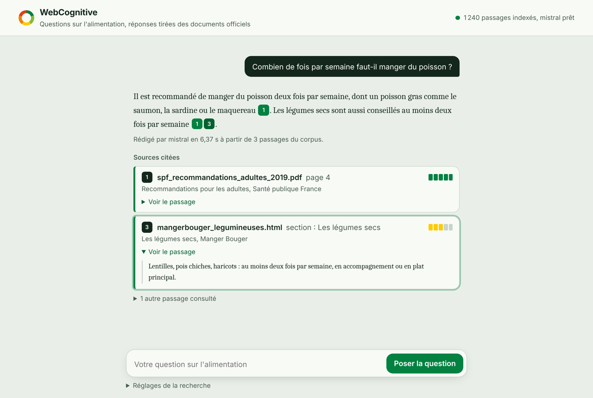
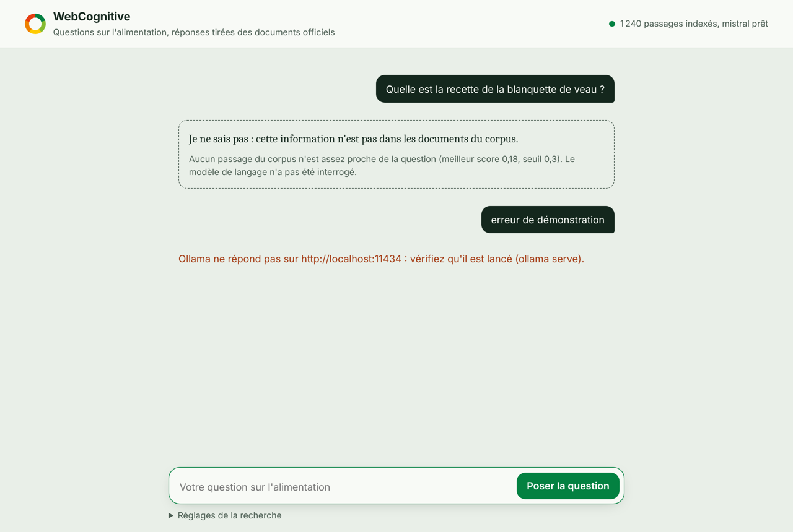

# WebCognitive Engine — Alimentation & Nutrition

Projet individuel du cours **Techniques Informatiques et Web**.
Objectif final : un moteur de recherche sémantique et un assistant (RAG, 100 % local)
capable de répondre à des questions sur un corpus de documents consacré à
**l'alimentation et la nutrition**.

## Avancement

| Étape | Contenu | État |
|---|---|---|
| 1 | Cadrage, corpus et stratégie d'ingestion | 🟡 corpus à télécharger |
| 2 | Pipeline d'ingestion et de parsing | ✅ code et tests |
| 3 | Chunking et embeddings | ✅ code et tests |
| 4 | Base vectorielle et API FastAPI | ✅ code et tests |
| 5 | RAG avec LLM local (Ollama) | ✅ code et tests |
| 6 | Front-end web | ✅ interface de chat |
| 7 | Dataviz | ⬜ |
| 8 | Validation finale et soutenance | ⬜ |

## Arborescence

```
webcognitive/
├── data/
│   ├── raw/                 ← documents bruts, NON modifiés
│   │   ├── pdf/
│   │   ├── html/
│   │   ├── docx/
│   │   └── txt/
│   ├── processed/           ← texte nettoyé (JSON), généré à l'étape 2
│   ├── vectors/             ← segments et vecteurs, générés à l'étape 3
│   └── chroma/              ← base vectorielle ChromaDB (étape 4)
├── frontend/                ← interface web de chat (HTML, CSS, JavaScript)
│   ├── index.html
│   ├── style.css
│   └── app.js
├── src/
│   ├── parsers.py           ← lecture PDF / HTML / DOCX / TXT
│   ├── cleaning.py          ← nettoyage et normalisation du texte
│   ├── ingest.py            ← pipeline d'ingestion + rapport (étape 2)
│   ├── chunking.py          ← découpage en segments avec chevauchement
│   ├── embeddings.py        ← modèle d'embedding local, similarité cosinus
│   ├── vectorize.py         ← découpage + vectorisation du corpus (étape 3)
│   ├── evaluate.py          ← test et optimisation avec les questions de validation
│   ├── vectorstore.py       ← base vectorielle ChromaDB (étape 4)
│   ├── indexation.py        ← pipeline d'indexation complet
│   ├── api.py               ← API REST FastAPI
│   ├── llm.py               ← client du LLM local (Ollama)
│   └── rag.py               ← recherche sémantique + pipeline RAG (étape 5)
├── tests/
│   ├── test_ingestion.py
│   ├── test_vectorisation.py
│   ├── test_indexation.py
│   ├── test_rag.py
│   └── test_interface.py
├── docs/
│   ├── cahier_des_charges.md
│   ├── sources.md           ← où trouver les documents
│   └── questions_validation.md
├── corpus_metadata.json     ← fiche descriptive de chaque document
├── requirements.txt
└── .gitignore
```

## Installation de l'environnement

```bash
python -m venv venv
# Linux / macOS
source venv/bin/activate
# Windows
venv\Scripts\activate

# Facultatif mais conseillé : PyTorch en version CPU (beaucoup plus léger)
pip install torch --index-url https://download.pytorch.org/whl/cpu

pip install -r requirements.txt
```

Le modèle d'embedding est téléchargé automatiquement au premier lancement
de l'étape 3 (environ 470 Mo pour le modèle multilingue), puis tout s'exécute en local.

## Règles de nommage des fichiers du corpus

- minuscules, sans accents ni espaces : `pnns_recommandations_2019.pdf`
- forme conseillée : `source_sujet_annee.extension`
- chaque fichier ajouté dans `data/raw/` doit avoir son entrée dans `corpus_metadata.json`

## Étape 2 — Lancer l'ingestion

```bash
python -m src.ingest                                # traite tout data/raw/
python -m src.ingest --fichier data/raw/pdf/x.pdf   # teste un seul fichier
python -m pytest -v                                 # lance les tests
```

Pour chaque document, le pipeline :
1. **lit** le fichier selon son format (pages du PDF, sections `<h1>`–`<h4>` du HTML,
   titres Word du DOCX, titres `#` ou en MAJUSCULES du TXT) ;
2. **nettoie** le texte : Unicode normalisé, ligatures (`fi` → `fi`), espaces insécables,
   césures de fin de ligne, en-têtes / pieds de page et numéros de page des PDF,
   menus / pieds de page / scripts des pages HTML ;
3. **écrit** `data/processed/<id>.json` : texte découpé en **blocs**, chacun avec sa
   position (`page 3`, `section : Le sel`) pour pouvoir citer la source plus tard.

Le fichier `data/processed/rapport_ingestion.json` fait le bilan et signale :
PDF probablement scannés, fichiers sans fiche dans `corpus_metadata.json`,
fiches dont le fichier est introuvable, `nombre_documents` incohérent, encodage non UTF-8.

Exemple de sortie :

```json
{
  "id": "doc_001",
  "fichier": "data/raw/html/sante_fr_sel.html",
  "format": "html",
  "titre": "Limiter les produits salés et le sel",
  "metadonnees": { "...": "entrée de corpus_metadata.json" },
  "statistiques": { "nombre_blocs": 4, "nombre_pages": null, "nombre_caracteres": 3120, "nombre_mots": 512 },
  "avertissements": [],
  "blocs": [
    { "numero": 1, "position": "section : Le sel", "page": null, "section": "Le sel", "texte": "..." }
  ]
}
```

## Étape 3 — Découpage et vectorisation

```bash
python -m src.vectorize                     # segments de 500 caractères, chevauchement 100
python -m src.vectorize --sans-vecteurs     # découpage seul, pour vérifier les tailles
python -m src.evaluate --details            # tester plusieurs tailles avec les questions de validation
python -m src.evaluate --modeles multilingue,minilm   # comparer les deux modèles
```

**1. Découpage (chunking).** Chaque bloc de l'étape 2 est découpé en phrases,
puis les phrases sont regroupées jusqu'à environ 500 caractères. Le segment suivant
reprend les dernières phrases du précédent (chevauchement d'environ 100 caractères) :
une idée n'est jamais coupée entre deux segments. Règles :
- on ne coupe jamais au milieu d'une phrase (les abréviations « p. 12 », « env. 5 »,
  « M. Dupont » ne sont pas prises pour des fins de phrase) ; seule une phrase plus longue
  que la taille maximale est coupée, sur les espaces ;
- un segment ne déborde jamais de son bloc : il garde sa page ou sa section d'origine ;
- un dernier segment trop petit (moins d'un quart de la taille) est fusionné avec le précédent ;
- le texte vectorisé commence par le titre du document et la section
  (« Le sel — Où se cache le sel ? : … ») pour donner du contexte aux petits segments.

**2. Vectorisation.** Chaque segment devient un vecteur de 384 nombres grâce à
sentence-transformers, exécuté en local sur le processeur. Les vecteurs sont normalisés :
la similarité cosinus entre une question et un segment est alors un simple produit scalaire.

| Modèle | Option | Pourquoi |
|---|---|---|
| paraphrase-multilingual-MiniLM-L12-v2 | `multilingue` (par défaut) | entraîné sur plus de 50 langues dont le français ; 384 dimensions |
| all-MiniLM-L6-v2 | `minilm` | modèle cité dans la fiche ; plus rapide, mais entraîné surtout sur de l'anglais |

Le corpus étant en français, le modèle multilingue est utilisé par défaut ;
`python -m src.evaluate --modeles multilingue,minilm` permet de vérifier ce choix sur nos questions.

**3. Sorties** (`data/vectors/`) :
- `segments.jsonl` : un segment par ligne, avec son document, sa page ou section
  et ses positions de début et de fin dans le bloc ;
- `embeddings.npy` : la matrice des vecteurs (une ligne par segment, dans le même ordre) ;
- `index.json` : modèle, taille, chevauchement, durée et statistiques.

**4. Test et optimisation.** `python -m src.evaluate` découpe et vectorise le corpus
pour plusieurs tailles (250, 500, 800, 1200 caractères), pose chaque question de
`docs/questions_validation.md` et mesure si le bon document arrive en tête :

| Mesure | Signification |
|---|---|
| Top-1 / Top-3 / Top-5 | part des questions dont le bon document est dans les 1, 3 ou 5 premiers segments |
| MRR | moyenne de 1 / rang du premier bon segment (1 = toujours premier) |
| Pos. | bonne page ou section dans le top-5 |
| Score / Piège | similarité du meilleur segment pour les vraies questions, et la plus haute obtenue par une question hors corpus |

Des segments trop petits manquent de contexte ; trop grands, ils mélangent plusieurs
sujets et le sens se dilue. La meilleure configuration est marquée ◀ et les résultats
sont enregistrés dans `data/vectors/evaluation.json`. L'écart entre « Score » et « Piège »
servira à fixer, à l'étape 5, le seuil sous lequel l'assistant répond que l'information
n'est pas dans le corpus.

⚠️ Seules les questions dont la colonne « Fichier source » est remplie sont évaluées.

## Étape 4 — Base vectorielle et API d'indexation

```bash
uvicorn src.api:app --reload        # ou : python -m src.api
```

Puis ouvrir **http://127.0.0.1:8000/docs** : la documentation interactive Swagger,
générée automatiquement par FastAPI, permet d'essayer chaque route depuis le navigateur.

### La base vectorielle : ChromaDB

ChromaDB est une base de données orientée vecteurs, libre, qui s'exécute en local
et enregistre ses données dans `data/chroma/`. Pour chaque segment, elle stocke **de manière liée** :

| Élément | Exemple |
|---|---|
| identifiant unique | `doc_001_s0004` |
| vecteur | 384 nombres (modèle de l'étape 3) |
| texte original | « Manger du poisson 2 fois par semaine, dont un poisson gras. » |
| métadonnées | fichier source, page ou section, titre, format, auteur, URL, date, position dans le bloc |

La collection utilise la distance cosinus. Ses propres métadonnées gardent les réglages
de l'indexation (modèle, taille, chevauchement, date) : une recherche utilise toujours
**le même modèle** que celui qui a servi à indexer, sinon les vecteurs ne seraient pas comparables.

### Les routes de l'API

| Méthode | Route | Rôle |
|---|---|---|
| GET | `/sante` | l'API répond-elle ? combien de segments en base ? |
| **POST** | **`/index`** | **indexation complète du corpus, renvoie un rapport JSON** |
| DELETE | `/index` | vide la base |
| GET | `/stats` | réglages de la dernière indexation, nombre de documents par format |
| GET | `/documents` | documents indexés et nombre de segments par document |
| GET | `/segments/{id}` | un segment avec son texte et ses métadonnées |
| GET | `/recherche?q=…` | vérification : les segments les plus proches d'une question |

`POST /index` enchaîne tout le pipeline :
1. ingestion de `data/raw/` (étape 2), si `"ingestion": true` ;
2. lecture des fichiers nettoyés de `data/processed/` ;
3. découpage avec chevauchement et vectorisation locale (étape 3) ;
4. enregistrement **par lots de 500** dans ChromaDB, après avoir vidé la base
   (aucun segment périmé ne reste si un document a été modifié ou retiré).

Une seule indexation peut tourner à la fois (sinon : erreur 409).

```bash
curl -X POST http://127.0.0.1:8000/index -H "Content-Type: application/json" \
     -d '{"ingestion": true, "taille": 500, "chevauchement": 100}'
```

Exemple de rapport renvoyé :

```json
{
  "statut": "termine",
  "ingestion": {"documents_traites": 35, "par_format": {"pdf": 12, "html": 12, "docx": 6, "txt": 5}, "erreurs": []},
  "reglages": {"modele": "sentence-transformers/paraphrase-multilingual-MiniLM-L12-v2", "dimensions": 384,
               "taille": 500, "chevauchement": 100},
  "documents": 35,
  "segments": 1240,
  "segments_en_base": 1240,
  "durees_s": {"ingestion": 4.1, "lecture": 0.1, "decoupage": 0.3, "vectorisation": 38.2, "enregistrement": 1.9}
}
```
*(chiffres d'illustration)*

La route `/recherche` sert à vérifier l'index ; le moteur de recherche complet et la
génération de réponse avec un LLM local viendront à l'étape 5.

## Étape 5 — Recherche sémantique et RAG avec un LLM local

### Installer le LLM local (une seule fois)

1. Installer **Ollama** (libre, Windows / macOS / Linux) : https://ollama.com
2. Télécharger un modèle : `ollama pull mistral` (environ 4 Go)
   — sur un ordinateur avec peu de mémoire, `ollama pull llama3.2:3b` (environ 2 Go) puis `--llm llama3.2:3b`.
3. Ollama tourne ensuite en arrière-plan sur http://localhost:11434 (sinon : `ollama serve`).

### Poser des questions

```bash
python -m src.rag "Combien de fois par semaine faut-il manger du poisson ?"
python -m src.rag --validation        # les 15 questions de validation + les 2 pièges
```

ou depuis l'API (Swagger : http://127.0.0.1:8000/docs) avec **POST `/chat`** :

```bash
curl -X POST http://127.0.0.1:8000/chat -H "Content-Type: application/json" \
     -d '{"question": "Combien de fois par semaine faut-il manger du poisson ?", "k": 5}'
```

### Le pipeline, étape par étape

1. **Recherche sémantique (Top-K).** La question est transformée en vecteur avec le même
   modèle que l'indexation, puis comparée à tous les segments par **similarité cosinus**.
   On garde les K segments les plus proches (5 par défaut). La route `GET /recherche`
   renvoie ce résultat seul, sans LLM.
2. **Fusion des voisins.** Deux segments qui se chevauchent dans le même bloc
   (à cause du chevauchement de l'étape 3) sont réunis en une seule source,
   pour ne pas envoyer deux fois le même texte au LLM.
3. **Seuil de pertinence.** Si même le meilleur segment a un score inférieur au seuil
   (0,30 par défaut), le système répond directement « Je ne sais pas » **sans appeler le LLM** :
   aucune invention possible. Le seuil se calibre avec la colonne « Piège » de `python -m src.evaluate`.
4. **Prompt strict.** Les segments sont injectés, numérotés, dans le prompt :

   ```
   [système] À partir uniquement du contexte textuel fourni ci-dessous, réponds précisément
             à la question de l'utilisateur. Si la réponse n'est pas dans le contexte, réponds
             exactement : « Je ne sais pas : cette information n'est pas dans les documents du corpus. »
             Cite tes sources avec leur numéro entre crochets [1]… Reprends les chiffres exactement…
   [utilisateur] Contexte :
             [1] Repères alimentaires — page 4 (spf_recommandations_2019.pdf)
             Manger du poisson 2 fois par semaine, dont un poisson gras…
             [2] …
             Question : Combien de fois par semaine faut-il manger du poisson ?
   ```
   La température du modèle est basse (0,1) pour des réponses factuelles et stables.
5. **Génération et traçabilité.** Le LLM local répond. La réponse est renvoyée avec ses sources :
   fichier, page ou section, score, extrait, et l'indication des sources réellement citées par le LLM.

Exemple de réponse de `POST /chat` :

```json
{
  "question": "Combien de fois par semaine faut-il manger du poisson ?",
  "reponse": "Il est recommandé de manger du poisson deux fois par semaine, dont un poisson gras [1].",
  "hors_corpus": false,
  "llm_appele": true,
  "modele_llm": "mistral",
  "meilleur_score": 0.71,
  "sources": [
    {"numero": 1, "citee": true, "score": 0.71, "fichier": "data/raw/pdf/spf_recommandations_2019.pdf",
     "position": "page 4", "extrait": "Manger du poisson 2 fois par semaine, dont un poisson gras…"}
  ],
  "durees_s": {"recherche": 0.05, "generation": 6.3}
}
```
*(chiffres d'illustration)*

## Étape 6 — Interface web de chat

```bash
uvicorn src.api:app --reload
```

Puis ouvrir **http://127.0.0.1:8000/** : l'API sert directement l'interface (dossier `frontend/`).



### Choix techniques

- **HTML5, CSS3 et JavaScript sans framework.** L'interface est servie par FastAPI
  (`/app/`) : rien de plus à installer, et le front-end reste indépendant du back-end
  (il ne parle à l'API que par des requêtes HTTP).
- **Requêtes asynchrones** avec `fetch` et `async/await` vers les routes de l'API :
  `GET /sante` (état de la base et du LLM), `POST /chat` (question → réponse), `POST /index` (réindexation).
- **100 % hors ligne** : aucune police ni bibliothèque chargée depuis Internet ;
  l'interface utilise les polices installées sur l'ordinateur.
- Pour ouvrir l'interface depuis une autre adresse : `index.html?api=http://127.0.0.1:8000`
  (l'API autorise ces appels grâce au middleware CORS).

### Ce que voit l'utilisateur

| Élément | Rôle |
|---|---|
| Indicateur d'état (en haut à droite) | nombre de passages indexés et disponibilité du LLM (Ollama) |
| Exemples de questions | lancer une première question en un clic |
| Réponse | texte rédigé par le LLM local ; les citations **[1]**, **[2]** sont des boutons |
| Sources citées | sous chaque réponse : **nom du fichier, page ou section**, titre, auteur et pertinence |
| Voir le passage | l'extrait exact transmis au LLM ; un clic sur une citation l'ouvre et le met en évidence |
| Autres passages consultés | les passages fournis au LLM mais non cités, repliés |
| Réponse hors corpus | encadré en pointillés, avec la raison (score sous le seuil, LLM non interrogé) |
| Erreurs | message clair et marche à suivre (API arrêtée, Ollama arrêté, modèle absent) |
| Réglages de la recherche | nombre de passages (K), seuil, format des documents, modèle, bouton de réindexation |

La **jauge de pertinence** de chaque source reprend les 5 couleurs du Nutri-Score :
plus la similarité cosinus avec la question est élevée, plus la jauge est pleine et verte.

Pendant la génération (parfois plusieurs dizaines de secondes sur processeur),
l'interface affiche le temps écoulé. Entrée envoie la question, Maj + Entrée passe à la ligne.
L'interface s'adapte aux écrans de téléphone et se navigue au clavier.

| Cas hors corpus et erreur | Sur téléphone |
|---|---|
|  |  |

*Captures réalisées avec un back-end de démonstration (réponses et chiffres d'exemple).*
