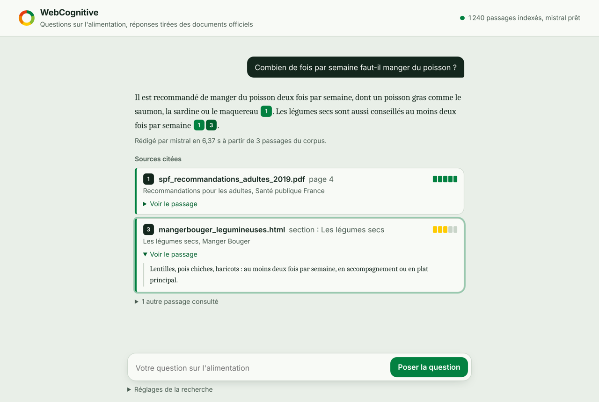
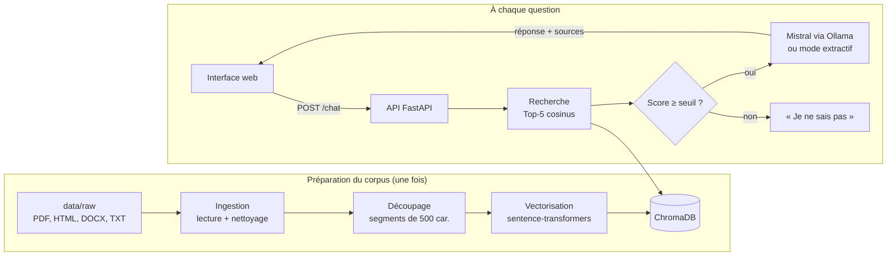
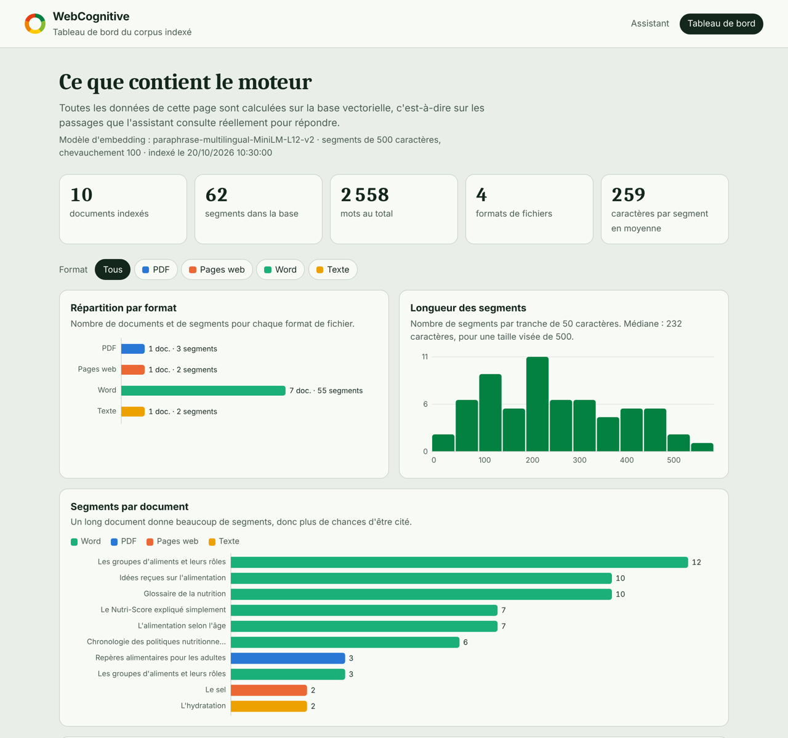

# WebCognitive Engine — Alimentation & Nutrition

Moteur de recherche sémantique et assistant de type **RAG** (*Retrieval-Augmented Generation*),
**100 % local**, qui répond en langage naturel à des questions sur l'alimentation et la nutrition
en citant ses sources : fichier, page ou section.

Projet individuel du cours **Techniques Informatiques et Web** — Master 2 Technologies de
l'Hypermédia (THYP), Université Paris 8 — Leiticia Atmane, 2026.



## Sommaire

1. [Le projet](#le-projet)
2. [Le corpus](#le-corpus)
3. [Architecture](#architecture)
4. [Installation pas à pas](#installation-pas-à-pas)
5. [Utilisation](#utilisation)
6. [Résultats](#résultats)
7. [Tests et validation](#tests-et-validation)
8. [Structure du dépôt](#structure-du-dépôt)
9. [Limites et perspectives](#limites-et-perspectives)
10. [Documentation](#documentation)

## Le projet

On pose une question en français, par exemple « Combien de fois par semaine faut-il manger du poisson ? »,
et l'application :
1. retrouve dans le corpus les passages dont le **sens** est le plus proche de la question ;
2. répond **uniquement à partir de ces passages** et affiche la source de chacun ;
3. dit qu'elle ne sait pas quand la réponse n'est pas dans le corpus.

Tout s'exécute sur l'ordinateur, avec des logiciels libres : aucune donnée n'est envoyée en ligne
et aucun service payant n'est utilisé.

| Fonctionnalité | Technologie |
|---|---|
| Lecture des PDF, pages web, documents Word et fichiers texte | pypdf, BeautifulSoup, python-docx, charset-normalizer |
| Découpage du texte et vecteurs sémantiques (384 dimensions) | sentence-transformers (`paraphrase-multilingual-MiniLM-L12-v2`) |
| Base vectorielle locale | ChromaDB |
| API REST et documentation interactive | FastAPI, Uvicorn |
| Rédaction des réponses par un LLM local | Ollama + Mistral (facultatif : sinon, mode extractif) |
| Interface de questions et tableau de bord | HTML, CSS et JavaScript, sans framework |
| Tests | pytest (70 tests) |

## Le corpus

**Thème : l'alimentation et la nutrition** — recommandations officielles (PNNS), repères de consommation,
Nutri-Score, publics spécifiques (enfants, femmes enceintes, personnes âgées), activité physique,
surpoids et obésité. Hors périmètre : recettes, régimes « miracles », conseils médicaux individuels
(voir le [cahier des charges](docs/cahier_des_charges.md)).

| Format | Documents | Sources |
|---|---|---|
| PDF | 11 | Santé publique France, Anses, ministère de la Santé (PNNS 4), Nutri-Score |
| HTML | 5 | fiches « Manger Bouger » de Santé publique France |
| DOCX | 6 | notes de synthèse rédigées pour le projet |
| TXT | 5 | articles de référence (fibres, sucres, aliments ultra-transformés) |
| **Total** | **27** | **542 376 mots** |

Chaque document est décrit dans [`corpus_metadata.json`](corpus_metadata.json) (titre, auteur, source, sous-thème),
et les liens de téléchargement sont dans [`docs/sources.md`](docs/sources.md).

## Architecture



| Module | Rôle |
|---|---|
| `src/parsers.py`, `src/cleaning.py`, `src/ingest.py` | lire les 4 formats, nettoyer le texte, garder la page ou la section de chaque bloc |
| `src/chunking.py`, `src/embeddings.py`, `src/vectorize.py` | découper en segments avec chevauchement, calculer les vecteurs |
| `src/vectorstore.py`, `src/indexation.py` | enregistrer segments, vecteurs et métadonnées dans ChromaDB |
| `src/rag.py`, `src/llm.py` | recherche sémantique, prompt strict, appel au LLM local, mode extractif |
| `src/api.py` | API REST et service des pages web |
| `frontend/` | interface de questions (`index.html`) et tableau de bord (`dataviz.html`) |
| `src/dataviz.py` | statistiques du tableau de bord (ACP, TF-IDF, similarités) |
| `src/evaluate.py`, `src/validation.py` | évaluation des réglages et rapport de validation |

Le détail de chaque brique est dans la [spécification technique](docs/specification_technique.md).

## Installation pas à pas

Prérequis : **Python 3.10 ou plus**, **Git**, environ **3 Go d'espace disque** (7 Go avec Mistral).

### 1. Récupérer le projet

```bash
git clone https://github.com/leiticia44/-webcognitive.git
cd -webcognitive
```

### 2. Créer l'environnement virtuel et installer les dépendances

**Windows** (Invite de commandes) :
```bat
python -m venv venv
venv\Scripts\python.exe -m pip install -r requirements.txt
```

**Linux / macOS** :
```bash
python3 -m venv venv
source venv/bin/activate
pip install -r requirements.txt
```

Facultatif, pour une installation plus légère : installer d'abord PyTorch en version processeur,
`pip install torch --index-url https://download.pytorch.org/whl/cpu`.

> Sous Windows, si `python` n'est pas reconnu, utiliser le chemin complet de Python ; si PowerShell
> bloque les scripts, utiliser l'Invite de commandes. Dans la suite, remplacer `python` par
> `venv\Scripts\python.exe` si l'environnement n'est pas activé.

### 3. Installer le modèle de langage (facultatif)

1. Installer **Ollama** depuis https://ollama.com.
2. Télécharger le modèle : `ollama pull mistral` (environ 4 Go).
3. Ollama tourne ensuite en arrière-plan sur http://localhost:11434 (sinon : `ollama serve`).

Sans Ollama, l'application fonctionne en **mode extractif** : elle recopie les phrases les plus
pertinentes du document au lieu de rédiger une réponse.

### 4. Préparer le corpus

```bash
python -m src.ingest
```

Lit les documents de `data/raw/`, écrit le texte nettoyé dans `data/processed/` et affiche un rapport
(environ 2 minutes pour les 27 documents).

### 5. Lancer l'API et l'interface

```bash
uvicorn src.api:app
```

Puis, dans le navigateur, ouvrir **http://127.0.0.1:8000/docs** et lancer **POST /index**
(**Try it out**, puis **Execute**) pour remplir la base. La première fois, le modèle d'embedding
(environ 470 Mo) est téléchargé, puis l'indexation dure environ 15 minutes sur processeur.
La base est enregistrée dans `data/chroma/` : il n'y a pas à recommencer au prochain lancement.

### 6. Utiliser l'application

| Adresse | Page |
|---|---|
| http://127.0.0.1:8000/ | l'assistant de questions |
| http://127.0.0.1:8000/app/dataviz.html | le tableau de bord du corpus |
| http://127.0.0.1:8000/docs | la documentation interactive de l'API |

## Utilisation

Le [manuel d'utilisation](docs/manuel_utilisateur.md) décrit l'interface, les réglages, le tableau de bord,
l'ajout de documents et les solutions aux problèmes courants. En résumé :

```bash
uvicorn src.api:app                                  # lancer l'application
python -m src.rag "Combien de fois par semaine faut-il manger du poisson ?"   # question en ligne de commande
python -m src.validation                             # poser les 15 questions de validation
python -m src.dataviz                                # résumé statistique du corpus
python -m src.metadonnees --ecrire                   # créer les fiches des nouveaux documents
```

| Route de l'API | Rôle |
|---|---|
| `POST /index` | ingestion et indexation complète du corpus, avec rapport JSON |
| `DELETE /index` | vider la base |
| `GET /recherche?q=…` | les passages les plus proches d'une question, sans LLM |
| `POST /chat` | réponse avec ses sources (mode génératif ou extractif) |
| `GET /stats`, `/documents`, `/segments/{id}` | contenu de la base |
| `GET /dataviz` | données du tableau de bord |
| `GET /sante` | état de la base et du modèle de langage |



*Les captures ont été réalisées pendant le développement, sur un corpus de démonstration.*

## Résultats

Mesurés sur l'ordinateur de développement (Windows 10, processeur seul, sans carte graphique).

| Mesure | Valeur |
|---|---|
| Documents lus | 27 sur 27, sans erreur |
| Texte extrait | 542 376 mots |
| Segments indexés | 9 690 (500 caractères, chevauchement de 100) |
| Durée de l'indexation | environ 15 min |
| Temps de réponse (mode extractif) | environ 2 s par question |
| Validation | **7 / 15** bonnes réponses avec la bonne source ; pièges évités 0 / 2 |

Analyse de la validation (détail dans [`docs/questions_validation.md`](docs/questions_validation.md)) :
- les réponses sont trouvées quand la question reprend les mots du document
  (fruits et légumes, Nutri-Score, poisson, viande, activité physique) ;
- elles sont manquées quand la question emploie un synonyme (« légumineuses » contre « légumes secs »)
  ou quand la réponse est noyée dans un très long rapport ;
- avec ce modèle d'embedding, les questions hors sujet obtiennent un score (0,61-0,62) proche de celui
  des bonnes réponses (0,63-0,86) : le seuil seul ne suffit pas à les écarter, et le prompt strict du
  LLM sert de second garde-fou en mode génératif ;
- le corpus contient une recette de blanquette de veau : la question piège correspondante a été remplacée.

## Tests et validation

```bash
python -m pytest -v          # 70 tests automatiques, sans rien télécharger
python -m src.validation     # recette sur les 15 questions et les questions pièges
```

- **Tests unitaires** : chaque brique (nettoyage, lecture des formats, découpage, base, RAG, API,
  tableau de bord) est testée avec un encodeur et un LLM factices.
- **Tests d'intégration** (`tests/test_recette.py`) : un corpus dans les 4 formats traverse toute la chaîne,
  des fichiers bruts jusqu'au rapport de validation, d'abord en Python puis par l'API REST et l'interface.
- **Validation** : `python -m src.validation` écrit `docs/rapport_validation.md`, qui place la réponse attendue
  et la réponse obtenue côte à côte avec des contrôles automatiques (source retrouvée, source citée, chiffres).

## Structure du dépôt

```
-webcognitive/
├── data/
│   ├── raw/                 ← documents du corpus (pdf/, html/, docx/, txt/), jamais modifiés
│   ├── processed/           ← texte nettoyé (généré, non versionné)
│   ├── vectors/             ← segments et évaluation (générés, non versionnés)
│   └── chroma/              ← base vectorielle (générée, non versionnée)
├── src/                     ← code Python (voir « Architecture »)
├── frontend/                ← interface web et tableau de bord
├── tests/                   ← 70 tests pytest
├── docs/
│   ├── cahier_des_charges.md
│   ├── specification_technique.md
│   ├── manuel_utilisateur.md
│   ├── sources.md
│   ├── questions_validation.md
│   ├── rapport_validation.md ← généré par python -m src.validation
│   └── captures/
├── corpus_metadata.json     ← fiche descriptive de chaque document
├── requirements.txt
└── README.md
```

## Limites et perspectives

| Limite | Piste d'amélioration |
|---|---|
| Synonymes mal reconnus (« légumineuses » / « légumes secs ») | recherche **hybride** : mots-clés (BM25) et sens combinés |
| Seuil de pertinence peu discriminant avec ce modèle | calibrer le seuil sur davantage de questions, ou ajouter un modèle de reclassement |
| Mistral non installé sur la machine de développement (connexion et espace disque) | comparer les modes extractif et génératif sur les 15 questions |
| Deux rapports représentent 70 % du texte | rééquilibrer le corpus et compléter les pages web (objectif : 35 documents) |
| Indexation lente sur processeur (15 min) | modèle d'embedding plus léger, ou carte graphique |

## Documentation

| Document | Contenu |
|---|---|
| [Cahier des charges](docs/cahier_des_charges.md) | objectifs, périmètre, public, fonctionnalités, critères de réussite |
| [Spécification technique](docs/specification_technique.md) | fonctionnement détaillé de chaque étape, schéma des données, routes, prompt, tests |
| [Manuel d'utilisation](docs/manuel_utilisateur.md) | utiliser l'assistant et le tableau de bord, ajouter des documents, résoudre les problèmes |
| [Sources du corpus](docs/sources.md) | où trouver chaque document |
| [Questions de validation](docs/questions_validation.md) | les 15 questions, les réponses attendues et les résultats |
